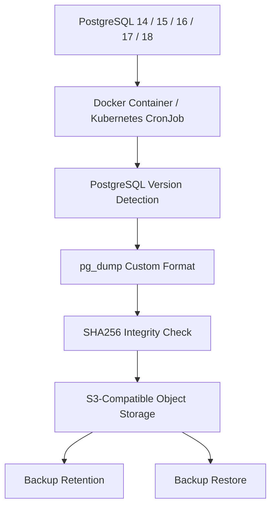

# PostgreSQL S3 Backup


## Overview

PostgreSQL S3 Backup is an open-source container-based project
designed to automate PostgreSQL logical backups and restores
using S3-compatible object storage.

The project aims to provide a lightweight, secure and portable
backup solution for Kubernetes, Docker and cloud-native environments.

A single container image includes multiple PostgreSQL client
versions, eliminating the need to maintain separate backup images
for different PostgreSQL server versions.

## Architecture



The diagram represents the target architecture.

## Features

- [x] Multiple PostgreSQL client versions
- [x] PostgreSQL clients 14, 15, 16, 17 and 18
- [x] Python 3.12
- [x] Boto3 S3 SDK
- [x] Non-root container execution
- [x] Docker image build
- [ ] Automatic PostgreSQL version detection
- [ ] Automated logical backups
- [ ] SHA256 integrity verification
- [ ] S3 upload and download
- [ ] Automated backup restore
- [ ] Daily, weekly and monthly retention
- [ ] Structured JSON logging
- [ ] Prometheus metrics
- [ ] Kubernetes CronJob integration
- [ ] Helm chart
- [ ] GitHub Actions CI/CD
- [ ] Multi-architecture images (AMD64 and ARM64)

## PostgreSQL Client Support

| PostgreSQL | Client | Binary directory |
|------------|--------|------------------|
| 14 | Included | /usr/lib/postgresql/14/bin/ |
| 15 | Included | /usr/lib/postgresql/15/bin/ |
| 16 | Included / Default | /usr/lib/postgresql/16/bin/ |
| 17 | Included | /usr/lib/postgresql/17/bin/ |
| 18 | Included | /usr/lib/postgresql/18/bin/ |

The project uses PostgreSQL client packages from the official
PostgreSQL APT repository (PGDG).

Client installation has been validated during the image build.
End-to-end backup and restore tests are planned.

## Target Storage Compatibility

| Object Storage | Integration status |
|----------------|--------------------|
| IBM Cloud Object Storage | Planned pilot |
| Amazon S3 | Planned |
| MinIO | Planned |
| RustFS | Planned |
| Ceph Object Gateway | Planned |
| Cloudflare R2 | Planned |
| Other S3-compatible storage | Planned |

## Container Image

Planned Docker Hub repository:

    docker.io/turingapp/postgres-s3-backup

Docker Hub:

https://hub.docker.com/r/turingapp/postgres-s3-backup

The first stable release will be published after backup and
restore validation.

## Container Specifications

| Component | Configuration |
|-----------|---------------|
| Base image | python:3.12-slim-bookworm |
| Operating system | Debian Bookworm |
| Python | 3.12 |
| Boto3 | 1.43.113 |
| Default PostgreSQL client | 16 |
| Container user | pgbackup |
| UID | 10001 |
| GID | 10001 |
| Working directory | /app |
| Backup directory | /backup |
| Default timezone | UTC |

### Initial Image Size

| Metric | Size |
|--------|------|
| Docker disk usage | 349 MB |
| Docker content size | 87.3 MB |

Image size may change depending on the architecture,
dependencies and build date.

## Build

Clone the repository:

```bash
git clone https://github.com/HelionMendanha/postgres-s3-backup.git

cd postgres-s3-backup
```

Build the container image:

```bash
docker build \
  -t postgres-s3-backup:1.0.0-dev .
```

Check the image:

```bash
docker images postgres-s3-backup
```

## Usage

### Check the default PostgreSQL client

```bash
docker run --rm postgres-s3-backup:1.0.0-dev
```

### Check all PostgreSQL client versions

```bash
docker run --rm postgres-s3-backup:1.0.0-dev \
  bash -c '
    for version in 14 15 16 17 18
    do
      /usr/lib/postgresql/$version/bin/pg_dump --version
      /usr/lib/postgresql/$version/bin/pg_restore --version
      /usr/lib/postgresql/$version/bin/psql --version
    done
  '
```

### Check Python and Boto3

```bash
docker run --rm postgres-s3-backup:1.0.0-dev \
  python -c "import boto3; print(boto3.__version__)"
```

### Validate non-root execution

```bash
docker run --rm postgres-s3-backup:1.0.0-dev id
```

Expected UID and GID:

    uid=10001(pgbackup) gid=10001(pgbackup)

### Validate backup directory permissions

```bash
docker run --rm postgres-s3-backup:1.0.0-dev \
  bash -c 'touch /backup/.test && rm /backup/.test'
```

## Planned Configuration

The following environment variables describe the planned
configuration interface.

The current image does not yet implement automated backup
processing.

### PostgreSQL

| Variable | Description | Default |
|----------|-------------|---------|
| PGHOST | PostgreSQL hostname | Required |
| PGPORT | PostgreSQL port | 5432 |
| PGDATABASE | Database name | Required |
| PGUSER | PostgreSQL user | Required |
| PGPASSWORD | PostgreSQL password | Required |
| PG_MAJOR | PostgreSQL client major version | 16 |
| PGSSLMODE | PostgreSQL SSL mode | Deployment-specific |

### S3 Object Storage

| Variable | Description |
|----------|-------------|
| S3_ENDPOINT | S3-compatible endpoint URL |
| S3_BUCKET | Destination bucket |
| S3_PREFIX | Backup object prefix |
| AWS_ACCESS_KEY_ID | S3 access key |
| AWS_SECRET_ACCESS_KEY | S3 secret key |
| AWS_DEFAULT_REGION | Object storage region |

### Backup Retention

| Variable | Description | Default |
|----------|-------------|---------|
| RETENTION_DAILY | Number of daily backups | 7 |
| RETENTION_WEEKLY | Number of weekly backups | 4 |
| RETENTION_MONTHLY | Number of monthly backups | 3 |

## Backup Strategy

The planned backup workflow consists of:

1. Connect to the PostgreSQL server.
2. Detect the PostgreSQL server version.
3. Select the appropriate PostgreSQL client.
4. Generate a logical backup using pg_dump.
5. Validate the backup archive.
6. Calculate the SHA256 checksum.
7. Upload the backup to S3-compatible storage.
8. Verify the uploaded backup integrity.
9. Apply the configured retention policy.
10. Report backup execution status.

Backups will use PostgreSQL custom format:

    pg_dump -Fc

The custom format supports compression, selective restore
and parallel restoration.

## Retention Policy

The proposed default retention strategy follows a
Grandfather-Father-Son (GFS) model.

| Backup Type | Retention |
|-------------|-----------|
| Daily | 7 backups |
| Weekly | 4 backups |
| Monthly | 3 backups |

Retention will be configurable for each deployment.

Automatic deletion will only be enabled after successful
backup and retention-policy validation.

## Kubernetes Integration

The project is designed for deployment using Kubernetes
CronJobs and GitOps workflows.

Planned support includes:

- Kubernetes CronJobs
- Kubernetes Secrets
- External Secrets Operator
- Helm
- Argo CD
- NetworkPolicies
- Pod Security Standards
- Prometheus monitoring

Potential deployment environments include:

- IBM Cloud Kubernetes Service (IKS)
- Amazon Elastic Kubernetes Service (EKS)
- Azure Kubernetes Service (AKS)
- Google Kubernetes Engine (GKE)
- Rancher / RKE2
- K3s
- On-premises Kubernetes

## Security

The project follows container security best practices:

- Non-root container execution.
- Dedicated UID and GID.
- No embedded credentials.
- No database passwords stored in source code.
- No backup files committed to Git.
- TLS verification for object storage connections.

Additional runtime hardening is planned:

- Read-only root filesystem.
- Linux capability restrictions.
- RuntimeDefault seccomp profile.
- Kubernetes Secret injection.
- NetworkPolicy restrictions.
- Immutable container image digests.
- Automated vulnerability scanning.

Never commit database passwords, access keys, secret keys,
backup files or internal infrastructure configuration
to this public repository.

## Backup Limitations

This project focuses on PostgreSQL logical backups.

Logical backups are not a replacement for physical backups,
WAL archiving or Point-in-Time Recovery (PITR).

Database roles, tablespaces and other cluster-wide objects
require a separate backup strategy.

A backup should only be considered recoverable after a
successful restore test.

## Roadmap

### Version 1.0.0

- Multi-version PostgreSQL container image.
- Automated PostgreSQL logical backups.
- Automatic PostgreSQL version detection.
- S3-compatible upload.
- SHA256 integrity verification.
- Backup restore validation.
- Configurable retention.
- Kubernetes CronJob deployment.

### Version 1.1.0

- Structured JSON logs.
- Prometheus metrics.
- Helm chart.
- GitHub Actions automation.
- Multi-architecture container images.
- Automated security scanning.

### Future Versions

- Backup encryption.
- Backup immutability support.
- Parallel backup strategies.
- Multiple database discovery.
- Backup notifications.
- Automated restore testing.

## Project Structure

Current structure:

```text
postgres-s3-backup/
├── Dockerfile
├── .dockerignore
├── .gitignore
└── README.md
```

Planned structure:

```text
postgres-s3-backup/
├── Dockerfile
├── README.md
├── LICENSE
├── requirements.txt
├── .dockerignore
├── .gitignore
├── scripts/
│   ├── backup.py
│   ├── restore.py
│   ├── retention.py
│   └── common.py
├── tests/
├── examples/
│   ├── docker/
│   └── kubernetes/
├── charts/
│   └── postgres-s3-backup/
└── .github/
    └── workflows/
        └── docker-publish.yaml
```

## Contributing

Contributions, bug reports and feature requests are welcome.

Please open an issue or submit a pull request:

https://github.com/HelionMendanha/postgres-s3-backup/issues

## License

MIT License is the proposed license for this project.
The LICENSE file will be added before the first stable release.

## Author

Helion Mendanha

Database Administration | DevOps | Kubernetes | Cloud Infrastructure

GitHub: https://github.com/HelionMendanha

---

PostgreSQL S3 Backup — Portable, secure and reliable database backups.